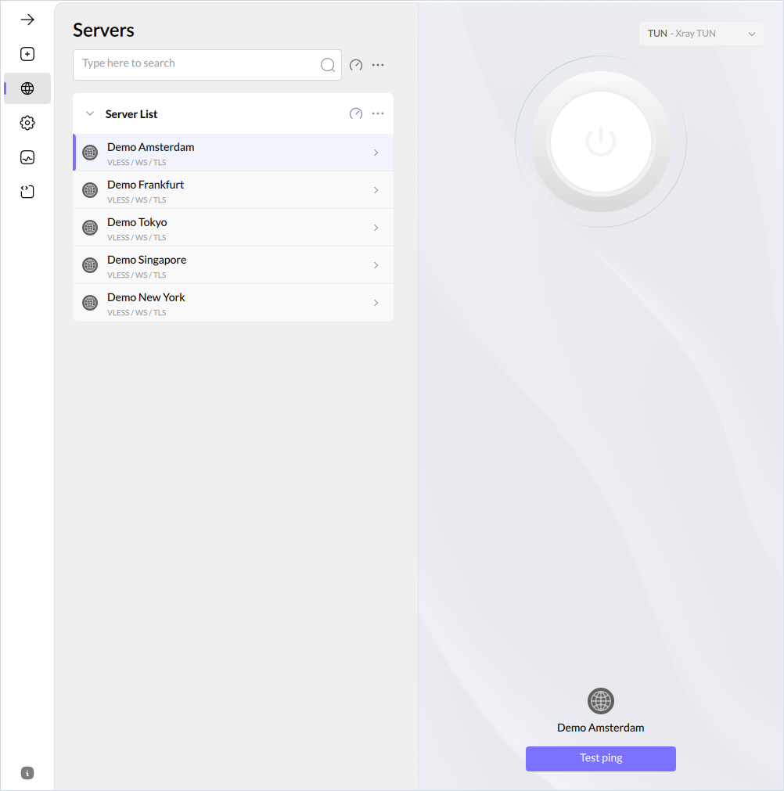

[Русский](README.ru.md) | **English**

# happ-nix

[](https://github.com/MaximRock/happ-nix/actions/workflows/ci.yml)
[](https://github.com/MaximRock/happ-nix/releases/latest)
[](LICENSE)

Unofficial [Happ](https://github.com/Happ-proxy/happ-desktop) package and NixOS
module. Happ is a desktop proxy client powered by Xray (VLESS, VMess, Trojan,
Shadowsocks).

<p align="center">
  
</p>

<p align="center"><sub>Happ UI with demo servers. No real subscriptions.</sub></p>

## Why this flake

- **Flake-first:** `nixosModules.default`, `packages`, `overlay` and `checks`.
- **Runs from `/nix/store`:** no `/opt/happ` materialisation step.
- **HWID fix:** creates the `/var/lib/dbus/machine-id` symlink Happ needs.
- **TUN when you want it:** opt-in kernel module, loose reverse-path filter and
  trusted interface.
- **Wayland workaround:** `forceXwayland` for wlroots compositors, plus optional
  software rendering for VMs.
- **Automated stable updates:** a weekly workflow builds the new `.deb` and
  opens a pull request.

The package repacks the official Linux x86_64 `.deb` with its bundled Qt
libraries. Happ binaries remain proprietary; this repository is not affiliated
with the Happ project.

## Quick start

Add the flake input:

```nix
{
  inputs.happ-nix.url = "github:MaximRock/happ-nix";
  inputs.happ-nix.inputs.nixpkgs.follows = "nixpkgs";
}
```

Use the module in your `flake.nix`:

```nix
{
  outputs = { nixpkgs, happ-nix, ... }: {
    nixosConfigurations.myhost = nixpkgs.lib.nixosSystem {
      modules = [
        happ-nix.nixosModules.default
        {
          services.happ.enable = true;
          services.happ.tunMode.enable = true;
          services.happ.forceXwayland = true;
        }
      ];
    };
  };
}
```

Then rebuild:

```sh
sudo nixos-rebuild switch --flake .#myhost
```

`forceXwayland` is recommended on wlroots-based compositors such as sway,
Hyprland and niri. Leave it off if native Wayland works for you.

## Options

| Option | Default | Description |
| --- | --- | --- |
| `services.happ.enable` | `false` | Install Happ and the `happd` service. |
| `services.happ.package` | built from `happ.nix` | Happ package to use. |
| `services.happ.forceXwayland` | `false` | Run through XWayland: set `QT_QPA_PLATFORM=xcb` and remove the bundled Wayland plugins. |
| `services.happ.forceSoftwareRendering` | `false` | Build with software Qt/OpenGL rendering. |
| `services.happ.tunMode.enable` | `false` | Enable TUN support (`tun` module, loose reverse-path filter, trusted interface). |
| `services.happ.tunMode.interface` | `"tun0"` | TUN interface name. |

`forceXwayland` and `forceSoftwareRendering` only affect the default package;
they are ignored when `services.happ.package` is overridden.

Only one `happd` can run at a time: it owns `/tmp/happd.sock` and the TUN
interface, so do not configure a second instance.

## Package without NixOS

```sh
nix build github:MaximRock/happ-nix
./result/bin/happ
```

The NixOS module is recommended for TUN and the HWID fix. Package-only usage
starts the GUI, but does not install the privileged `happd` service or the
machine-id symlink.

## How it works

The module installs the package, creates a root `happd` systemd service and a
symlink `/var/lib/dbus/machine-id -> /etc/machine-id`. The GUI talks to `happd`
over `/tmp/happd.sock`.

With `services.happ.tunMode.enable`, the module loads the `tun` kernel module,
sets `networking.firewall.checkReversePath = "loose"` and adds the interface to
`trustedInterfaces`. `happd` runs as root because it manages the TUN device and
routing; treat it as a privileged network service.

The package wrapper sets the runtime `PATH`, CA bundle, XKB data and Qt platform
environment. `forceXwayland` also removes the bundled Qt Wayland plugins, which
can crash the client on some compositors.

## Updates

`happ.nix` pins the official `.deb` by version and SRI hash. A weekly GitHub
Action runs `scripts/update.sh`, checks the latest stable release, builds it and
opens a pull request. Prereleases are ignored.

To update an existing flake input:

```sh
nix flake update happ-nix
```

Then rebuild your system. If the upstream `.deb` layout changes, the build fails
instead of silently producing a broken wrapper.

## Compatibility

- Tested on NixOS 26.05, `x86_64-linux` only.
- Wayland works through XWayland when `forceXwayland = true`; native Wayland may
  work on some setups.
- For VMs or systems without a working GPU driver, try
  `services.happ.forceSoftwareRendering = true`.
- Happ is proprietary software; the packaging code and module are GPL-3.0.

## Troubleshooting

**HWID is empty.** Enable the module and check that
`readlink -f /var/lib/dbus/machine-id` points to `/etc/machine-id`. Rebuild and
restart Happ after changing the module.

**Happ crashes or shows a blank window on Wayland.** Set
`services.happ.forceXwayland = true`. On VMs also try
`services.happ.forceSoftwareRendering = true`.

**TUN mode is enabled but traffic does not flow.** Rebuild after enabling
`services.happ.tunMode.enable`, then check `systemctl status happd` and
`journalctl -u happd -b`. Make sure no second `happd` instance is running.

**The GUI cannot connect to `happd`.** Check that `/tmp/happd.sock` exists and
that the `happd` service is running. Only one instance can own the socket.

**The build fails after an upstream update.** The `.deb` layout may have
changed; the error is intentional. Open an issue or pin the previous release.

## Compared with happ-nixos

This is an independent flake, not a fork of
[MrShitFox/happ-nixos](https://github.com/MrShitFox/happ-nixos).

| | happ-nix | happ-nixos |
| --- | --- | --- |
| Integration | Standalone flake with `nixosModules.default` | Cloned into `/etc/nixos` and imported as `happ-module.nix` |
| Package | Runs from `/nix/store` | Materialised under `/opt/happ` |
| TUN | Explicit `services.happ.tunMode.enable` and interface option | `tunInterface`; TUN settings always active with the module |
| Updates | Weekly PR and `nix flake update` | `git pull` and rebuild |

## Acknowledgements

Inspired by [MrShitFox/happ-nixos](https://github.com/MrShitFox/happ-nixos).
Thanks for the findings that made this work:

- **HWID:** dbus-broker does not create `/var/lib/dbus/machine-id`, so it must
  be symlinked to `/etc/machine-id`.
- **Wayland/wlroots:** bundled Qt6 Wayland plugins can crash the client;
  `forceXwayland` avoids them.
- **TUN:** the loose reverse-path filter, trusted interface and root `happd`
  service are required to launch the cores.

## License

The packaging code and NixOS module are licensed under GPL-3.0 (see
[LICENSE](LICENSE)). The bundled Happ binaries are proprietary software
distributed by the Happ project; this repository only repackages the official
release.

---

If this flake saved you time, consider starring the repository.
