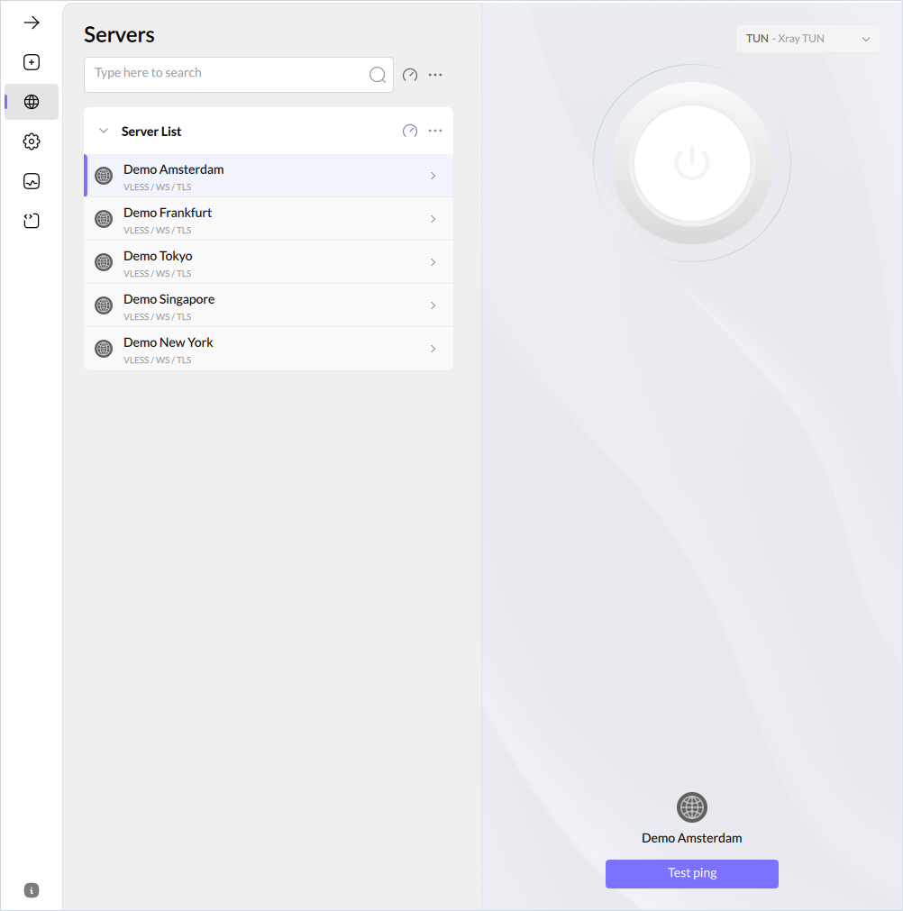

**Русский** | [English](README.md)

# happ-nix

[](https://github.com/MaximRock/happ-nix/actions/workflows/ci.yml)
[](https://github.com/MaximRock/happ-nix/releases/latest)
[](LICENSE)

Неофициальный пакет [Happ](https://github.com/Happ-proxy/happ-desktop) и
NixOS-модуль для него. Happ — десктопный прокси-клиент на базе Xray (VLESS,
VMess, Trojan, Shadowsocks).

<p align="center">
  
</p>

<p align="center"><sub>Интерфейс Happ с демо-серверами. Реальных подписок нет.</sub></p>

## Почему этот flake

- **Flake-first:** `nixosModules.default`, `packages`, `overlay` и `checks`.
- **Запуск из `/nix/store`:** без материализации в `/opt/happ`.
- **Исправление HWID:** создаёт симлинк `/var/lib/dbus/machine-id`, который
  нужен Happ.
- **TUN по желанию:** kernel-модуль, loose reverse-path filter и trusted
  interface включаются отдельной опцией.
- **Обход Wayland:** `forceXwayland` для wlroots-композиторов и software
  rendering для виртуалок.
- **Автообновления stable:** еженедельный workflow собирает новый `.deb` и
  открывает pull request.

Пакет переупаковывает официальный Linux x86_64 `.deb` с bundled Qt. Бинарники
Happ остаются проприетарными; репозиторий не связан с проектом Happ.

## Быстрый старт

Добавь input во flake:

```nix
{
  inputs.happ-nix.url = "github:MaximRock/happ-nix";
  inputs.happ-nix.inputs.nixpkgs.follows = "nixpkgs";
}
```

Подключи модуль в `flake.nix`:

```nix
{
  outputs = { nixpkgs, happ-nix, ... }: {
    nixosConfigurations.myhost = nixpkgs.lib.nixosSystem {
      modules = [
        happ-nix.nixosModules.default
        {
          services.happ.enable = true;
          services.happ.tunMode.enable = true;
          services.happ.forceXwayland = true;
        }
      ];
    };
  };
}
```

Затем пересобери систему:

```sh
sudo nixos-rebuild switch --flake .#myhost
```

`forceXwayland` рекомендован на wlroots-композиторах: sway, Hyprland, niri.
Если native Wayland у тебя работает, опцию можно не включать.

## Опции

| Опция | По умолчанию | Описание |
| --- | --- | --- |
| `services.happ.enable` | `false` | Установить Happ и сервис `happd`. |
| `services.happ.package` | сборка из `happ.nix` | Используемый пакет Happ. |
| `services.happ.forceXwayland` | `false` | Запуск через XWayland: `QT_QPA_PLATFORM=xcb` и удаление bundled Wayland-плагинов. |
| `services.happ.forceSoftwareRendering` | `false` | Сборка с software-рендерингом Qt/OpenGL. |
| `services.happ.tunMode.enable` | `false` | Поддержка TUN: модуль `tun`, loose reverse-path filter, trusted interface. |
| `services.happ.tunMode.interface` | `"tun0"` | Имя TUN-интерфейса. |

`forceXwayland` и `forceSoftwareRendering` влияют только на пакет по
умолчанию; при переопределении `services.happ.package` они игнорируются.

Одновременно может работать только один `happd`: он занимает `/tmp/happd.sock`
и TUN-интерфейс, поэтому второй экземпляр настраивать нельзя.

## Пакет без NixOS

```sh
nix build github:MaximRock/happ-nix
./result/bin/happ
```

Для TUN и исправления HWID рекомендуется NixOS-модуль. Package-only запускает
GUI, но не устанавливает привилегированный сервис `happd` и симлинк
machine-id.

## Как это работает

Модуль устанавливает пакет, создаёт root-сервис `happd` и симлинк
`/var/lib/dbus/machine-id -> /etc/machine-id`. GUI общается с `happd` через
`/tmp/happd.sock`.

С `services.happ.tunMode.enable` модуль загружает kernel-модуль `tun`,
выставляет `networking.firewall.checkReversePath = "loose"` и добавляет
интерфейс в `trustedInterfaces`. `happd` работает под root, потому что управляет
TUN-устройством и маршрутами; относись к нему как к привилегированному
сетевому сервису.

Wrapper пакета задаёт runtime `PATH`, CA bundle, XKB-данные и Qt-платформу.
`forceXwayland` дополнительно удаляет bundled Qt Wayland-плагины, которые могут
ронять клиент на некоторых композиторах.

## Обновления

`happ.nix` фиксирует официальный `.deb` по версии и SRI-хешу. Еженедельный
GitHub Action запускает `scripts/update.sh`, проверяет последний stable-релиз,
собирает его и открывает pull request. Prerelease-версии игнорируются.

Обновление существующего input'а:

```sh
nix flake update happ-nix
```

Затем пересобери систему. Если upstream изменит layout `.deb`, сборка упадёт,
а не создаст молча сломанный wrapper.

## Совместимость

- Проверено на NixOS 26.05, только `x86_64-linux`.
- Wayland работает через XWayland при `forceXwayland = true`; native Wayland
  может работать на некоторых конфигурациях.
- Для виртуалок и систем без рабочего GPU-драйвера попробуй
  `services.happ.forceSoftwareRendering = true`.
- Happ — проприетарное ПО; код упаковки и модуль распространяются под GPL-3.0.

## Решение проблем

**HWID пустой.** Включи модуль и проверь, что
`readlink -f /var/lib/dbus/machine-id` указывает на `/etc/machine-id`. После
изменения модуля пересобери систему и перезапусти Happ.

**Happ падает или показывает пустое окно на Wayland.** Включи
`services.happ.forceXwayland = true`. На виртуалках также попробуй
`services.happ.forceSoftwareRendering = true`.

**TUN включён, но трафик не идёт.** Пересобери систему после включения
`services.happ.tunMode.enable`, проверь `systemctl status happd` и
`journalctl -u happd -b`. Убедись, что не запущен второй `happd`.

**GUI не подключается к `happd`.** Проверь, что существует `/tmp/happd.sock` и
запущен сервис `happd`. Сокетом может владеть только один экземпляр.

**Сборка падает после обновления upstream.** Возможно, изменился layout
`.deb`; ошибка намеренная. Открой issue или зафиксируй предыдущий релиз.

## Отличия от happ-nixos

Это независимый flake, а не форк
[MrShitFox/happ-nixos](https://github.com/MrShitFox/happ-nixos).

| | happ-nix | happ-nixos |
| --- | --- | --- |
| Интеграция | Самостоятельный flake с `nixosModules.default` | Клонируется в `/etc/nixos` и импортируется как `happ-module.nix` |
| Пакет | Запускается из `/nix/store` | Материализуется в `/opt/happ` |
| TUN | Отдельные `services.happ.tunMode.enable` и опция интерфейса | `tunInterface`; TUN-настройки всегда активны с модулем |
| Обновления | Еженедельный PR и `nix flake update` | `git pull` и пересборка |

## Благодарности

Проект вдохновлён [MrShitFox/happ-nixos](https://github.com/MrShitFox/happ-nixos).
Спасибо за находки, которые помогли запустить Happ:

- **HWID:** dbus-broker не создаёт `/var/lib/dbus/machine-id`, поэтому нужен
  симлинк на `/etc/machine-id`.
- **Wayland/wlroots:** bundled Qt6 Wayland-плагины могут ронять клиент;
  `forceXwayland` обходит эту проблему.
- **TUN:** для запуска ядер нужны loose reverse-path filter, trusted interface
  и root-сервис `happd`.

## Лицензия

Код упаковки и NixOS-модуль распространяются под GPL-3.0 (см.
[LICENSE](LICENSE)). Бинарники Happ — проприетарное ПО проекта Happ; этот
репозиторий лишь переупаковывает официальный релиз.

---

Если flake сэкономил тебе время, поставь звезду репозиторию.
